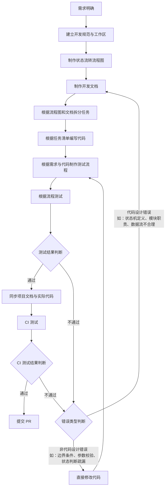

# 项目架构

## 1. 核心目标

本项目核心目标是通过 skills 组辅助开发者健康、快速地完成项目的开发与迭代。

- **健康**：每个阶段都有明确的输入与产物，设计与实现可追溯；出现问题时能判断错误类型，并回流到正确的阶段修复。
- **快速**：阶段职责单一、边界清晰，各 Skill 既可顺序串联走完整链路，也可按需单独调用其中一环。

## 2. 核心架构

本项目通过 skills 组间相互配合完成目标：上一个阶段的产物即下一个阶段的输入。开发链路的产物统一落在使用方项目的 `docs/` 目录下，项目文档则按其既有位置维护，形成可追溯的开发链路。核心状态流转流程图如下。

### 2.1 三类文档

架构中存在三类职责不同的文档，不可混用：

| 文档类型 | 定位 | 生命周期 | 典型位置 |
| --- | --- | --- | --- |
| **项目文档** | 描述项目**当前最新状态** | 长期维护，随代码演进持续更新 | `README.md`、`docs/` 下的常驻说明 |
| **开发规范** | 描述项目**当前最新的编码与目录约束** | 长期维护，只保留最新约束，变更写入迁移信息 | `docs/开发规范/` |
| **开发文档** | 指导**某一次开发**的设计与实现 | 有时效性，是本次开发的一系列迁移文档 | `docs/dev-docs/` |

- 项目文档只有一个「当前版本」，始终与真实代码对齐；开发文档按序号累积，记录每次开发的迁移过程。
- 开发规范同样只有一个「当前版本」，其历史变更写入 `docs/开发规范/迁移信息/<开发序号>-<规范名>.md`，规范文档内不保留历史版本。
- 因此「同步项目文档与实际代码」由 `project-doc-sync` 承担，`dev-doc-writer` 不负责项目文档；开发规范的建立与维护由 `spec-manager` 承担。

### 2.2 状态流转流程图

### 2.3 状态与 Skill 的对应关系

| 状态 | 承担 Skill | 主要输入 | 主要产物 |
| --- | --- | --- | --- |
| A 需求明确 | `issue-writer` | 用户口述需求、项目背景 | Issue（远端仓库）+ `docs/dev-docs/<开发序号>/<仓库名>-<issue编号>-issue.md` 本地留档 |
| A2 建立开发规范与工作区 | `spec-manager` | 已确认 Issue、项目代码与目录现状 | `docs/开发规范/Rust编码规范.md`、`docs/开发规范/项目目录架构规范.md`、`docs/dev-docs/<开发序号>/` 目录骨架、worktree（`<仓库名>-dev-<开发序号>`）与分支（`feat/<Issue编号>-<简述>`）、worktree 内的本次开发目录（经人类确认后登记到目录架构规范） |
| B 制作状态流转流程图 | `dev-doc-writer` | 已确认的 Issue | `docs/dev-docs/<开发序号>/<标题>流程图.md`（状态流转） |
| C 制作开发文档 | `dev-doc-writer` | Issue、代码库上下文、状态流转流程图 | `docs/dev-docs/<开发序号>/<标题>开发文档.md`（数据结构、函数定义） |
| D 拆分任务 | `task-planner` | 开发文档与流程图 | `docs/dev-docs/<开发序号>/task-list/` 下的任务文件与 `执行顺序.md` |
| E 编写代码 | `implementer` | 开发文档、流程图、任务清单 | 代码改动、`docs/dev-docs/<开发序号>/task-report/` 任务报告 |
| F 制作测试流程 | `test-planner` | 需求、开发文档、真实实现 | `docs/dev-docs/<开发序号>/test-process/` 三份测试流程文档及所需资源 |
| G 根据流程测试 | `test-runner` | 三份测试流程文档、工作区代码 | 执行记录、`docs/dev-docs/<开发序号>/test-report/` 测试报告或未通过报告 |
| H / J / K 判定与修复 | `test-runner` | 测试结果 | 代码改动（限非设计错误）或失败报告 |
| I 同步项目文档与实际代码 | `project-doc-sync` | 测试通过的 Rust 代码、rustdoc JSON 与 AST 事实、现有项目文档 | 公有接口源码 `///` 文档、`docs/data-struct-and-interface/<模块名>/` 模块接口与数据结构文档、项目说明（本版本仅支持 Rust） |
| L / M CI 测试 | `pr-creator` | 草稿 PR、CI 结果 | 最小修复提交、全部检查通过 |
| N 提交 PR | `pr-creator` | 代码、Issue、开发文档、测试报告 | PR 标题与正文、`docs/dev-docs/<开发序号>/<仓库名>-<PR编号>-PR.md` 本地副本 |

> B 与 C 由 `dev-doc-writer` 一并产出、均需人类批准后定稿：状态流转流程图是后续任务拆分、编码、测试与 CI 修复的共同设计基线。A2 由 `spec-manager` 承担：先建立规范文档，再分配开发序号与目录骨架，最后创建 worktree 与分支，并在其中确认本次开发目录（复用或新建）后登记到目录架构规范；无 Issue 时只产出规范与目录骨架。I 由 `project-doc-sync` 承担，只回写项目文档，不改动开发文档。

### 2.4 各 Skill 职责

| Skill | 职责 | 对应状态 |
| --- | --- | --- |
| `issue-writer` | 帮助开发者确定真实需求，并发起 Issue | A |
| `spec-manager` | 建立并维护开发规范，分配开发序号与隔离工作区 | A2 |
| `dev-doc-writer` | 根据需求制作状态流转流程图、制作开发文档 | B、C |
| `task-planner` | 将开发文档根据状态流转拆分成任务列表 | D |
| `implementer` | 根据任务列表编写代码 | E |
| `test-planner` | 根据需求、状态流转、开发文档、真实代码制作测试流程 | F |
| `test-runner` | 根据测试流程完成测试 | G、H、J、K |
| `project-doc-sync` | 根据实际代码更新项目文档 | I |
| `pr-creator` | 进行提交 PR 前的 CI 测试与提交 PR | L、M、N |

### 2.5 回流路径

流程图中有三条回流路径，分别对应不同性质的偏差：

| 路径 | 触发条件 | 回到的状态 | 含义 |
| --- | --- | --- | --- |
| H → J → K → F | 非代码设计错误（边界条件、参数校验、状态判断疏漏） | F 制作测试流程 | 设计不变，只修正代码细节；修正后重新校准测试流程并复测 |
| H → J → C | 代码设计错误（按已批准的状态流转图实现仍无法完成需求） | C 制作开发文档 | 设计本身不合理，须重新设计开发文档与流程图，再重新拆分与实现 |
| M → J | CI 测试不通过 | J 错误类型判断 | CI 失败同样按「非代码设计错误 / 代码设计错误」分流，不允许绕过 CI 直接提交 PR |

`I 同步项目文档与实际代码` 位于「测试通过」与「CI 测试」之间：只有经测试验证的代码才回写项目文档，保证项目文档与真实实现一致，避免项目文档滞后于代码。该状态由 `project-doc-sync` 执行；开发文档（含流程图）是本次开发的迁移记录，不随代码回写，也不再作为项目现状的依据。

## 3. 「设计错误」的定义

**如果根据已批准的状态流转图设计的代码并不能完成需求，视为设计错误。**

该定义决定了流程中的判断标准：

- 判定依据是**需求能否完成**；状态流转图与代码都是达成需求的手段，不以代码是否与流程图逐条一致作为设计错误的判据。
- 按已批准的状态流转图实现却仍无法完成需求 → 设计错误，须回到 B / C 重新设计状态流转图与开发文档；不得改代码迁就测试或 CI，也不得修改流程图迁就代码。
- 设计本身成立、仅实现细节有瑕疵（边界条件、参数校验、状态判断疏漏）→ 非代码设计错误，允许直接修改代码。
