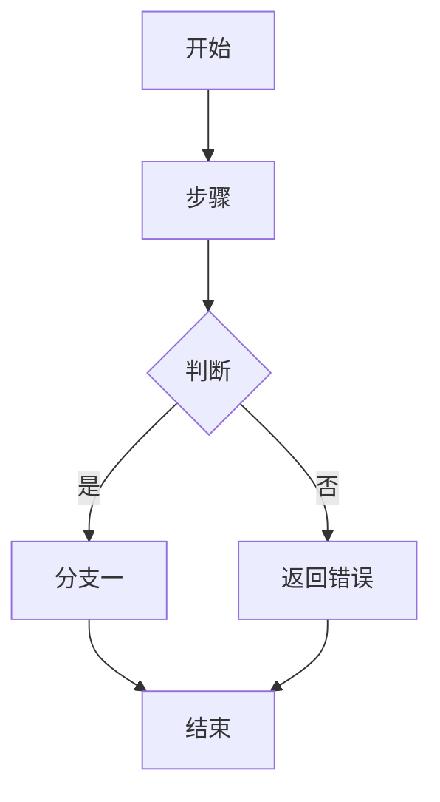
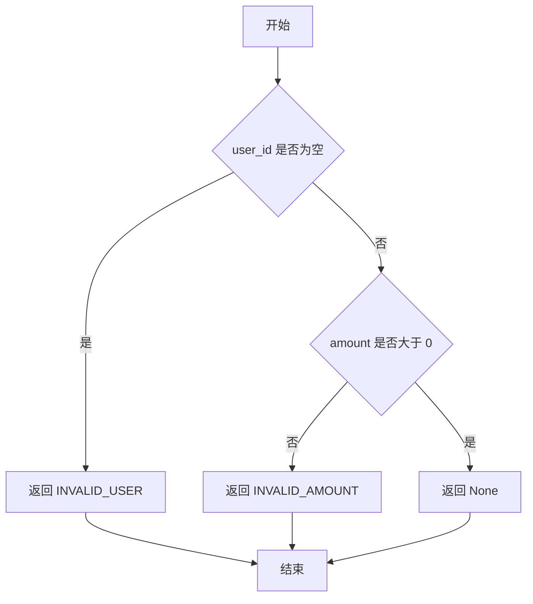

# <编号> <任务标题>

```json
{
  "编号": "<编号>",
  "依赖": ["<前置任务编号>", "<…>"]
}
```

# <编号> <任务标题>

- 任务：<任务标题>
- 工作区：<登记文件中的工作区名称>（<读写 / 只读>）——<具体目录或文件>
- 产出：<本任务交付的产物>
- 验收标准：
  - <可观察、可执行的判定依据>
  - <…>

> 文件最开头必须是上述 JSON 头，会被 `scripts/topo_sort.py` 读取：「编号」为字符串；「依赖」为数组，按前置任务编号逐个写入字符串，无依赖填 `[]`。

## 实现内容

> 从开发文档摘录本任务要实现的条目，格式与开发文档中的「数据结构」「函数定义」两节完全一致；与本任务无关的条目一律不写入，不需要的整节删除。函数条目还须追加本任务设计的「函数内部流程图」。

### 数据结构

> 每个数据结构写成一个条目，条目之间用 `---` 分隔。条目格式如下，「结构」按类型二选一：
>
> - **代码结构**（类、结构体等）：用类 py 伪代码描述，并为每个字段（元素）写注释；
> - **表格结构**（数据库表等）：用表格描述，表头即其每个字段。

---

名称：<名称>
类型：<类 / 结构体 等代码结构>
说明：<这个数据结构是什么、用来做什么>
结构：

```python
class <类型名>:
    <字段名>: <类型>  # <字段说明>
    <字段名>: <类型>  # <字段说明>
```

---

名称：<名称>
类型：<数据库表 / 表格结构>
说明：<这个数据结构是什么、用来做什么>
结构：

| <字段1> | <字段2> | <字段3> |
| --- | --- | --- |
| 类型 | 类型 | 类型 |
| 说明 | 说明 | 说明 |

---

### 函数定义

> 每个函数 / 方法写成一个条目，条目之间用 `---` 分隔。字段沿用「函数的设计规则」中的必含内容。

---

函数名称：<函数名>
公开属性：公有接口 / 公有函数 / 私有函数
多线程属性：普通 / 并发 / 异步
函数归属：独立函数 / <类（结构体）名>的方法
所属模块或包：<模块或包名；语言若无此概念可留空>
职责说明：<这个函数做什么>
入参列表：

| 名称 | 类型 | 是否必填 | 含义 |
| --- | --- | --- | --- |
| … | … | 是 / 否 | … |

返回值列表：

| 名称 | 类型 | 含义 |
| --- | --- | --- |
| … | … | … |

错误返回（如果没有错误返回则不填入此表）：

| 错误类型 | 错误码 | 错误场景 |
| --- | --- | --- |
| … | … | … |

校验规则：黑盒校验 / 白盒断言 / 不校验
调用关系：

| 方向 | 函数 |
| --- | --- |
| 调用（内部函数） | … |
| 被调用（调用方） | … |

函数内部流程图：

> 由 task-planner 在拆分任务时设计：依据开发文档中该函数的职责说明、入参、返回值、错误返回、调用关系，与同目录流程图的状态流转；只描述本函数自身的执行路径，不照搬整份流程图。



---

## 示例

以下是一个填好后的任务文件（文件名为 `001-create-orders-table.md`）：

```json
{
  "编号": "001",
  "依赖": []
}
```

# 001 创建订单表及索引

- 任务：创建订单表及索引
- 工作区：database（读写）——db/migrations
- 产出：orders 表及索引
- 验收标准：
  - 迁移脚本执行成功
  - orders 表字段与开发文档一致

## 实现内容

### 数据结构

---

名称：orders
类型：数据库表
说明：存储订单主记录
结构：

| id | user_id | amount | status | created_at |
| --- | --- | --- | --- | --- |
| bigint | bigint | decimal(10,2) | varchar(16) | timestamp |
| 主键 | 下单用户 id | 订单金额 | 订单状态 | 创建时间 |

---

以下是一个含函数实现的任务文件（文件名为 `002-create-order-validation.md`），同时演示依赖数组与函数内部流程图：

```json
{
  "编号": "002",
  "依赖": ["001"]
}
```

# 002 实现订单创建校验

- 任务：实现订单创建校验
- 工作区：order（读写）——src/order/validation.py
- 产出：validate_order 函数
- 验收标准：
  - 用户 id 为空时返回 INVALID_USER
  - 金额小于等于 0 时返回 INVALID_AMOUNT
  - 上述校验均通过时返回 None

## 实现内容

### 函数定义

---

函数名称：validate_order
公开属性：私有函数
多线程属性：普通
函数归属：独立函数
所属模块或包：order.validation
职责说明：校验待创建的订单数据，不合法时返回对应错误。
入参列表：

| 名称 | 类型 | 是否必填 | 含义 |
| --- | --- | --- | --- |
| order | Order | 是 | 待创建的订单数据 |

返回值列表：

| 名称 | 类型 | 含义 |
| --- | --- | --- |
| error | OrderError | 合法时为 None，否则为对应错误 |

错误返回：

| 错误类型 | 错误码 | 错误场景 |
| --- | --- | --- |
| OrderError | INVALID_USER | 用户 id 为空 |
| OrderError | INVALID_AMOUNT | 金额小于等于 0 |

校验规则：黑盒校验
调用关系：

| 方向 | 函数 |
| --- | --- |
| 调用（内部函数） | — |
| 被调用（调用方） | create_order |

函数内部流程图：



---
